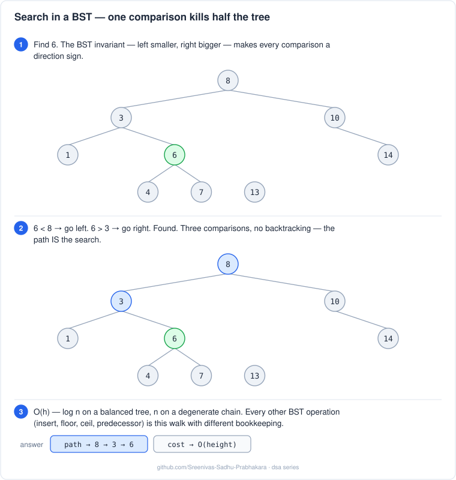

# Search in a BST

> Striver SDE Sheet 132 · Day 20 BST — one comparison per level steers left or right; a loop, not recursion, since the path never branches. Go, stdlib only, tested.

## Problem

Find the node holding a key in a binary search tree, or report its absence.

## Approach

The BST invariant — everything left is smaller, everything right is larger — makes search a corridor, not a maze: at each node exactly one child can contain the key, so the "recursion" is a straight path and deserves to be a loop (no stack frames, no O(h) memory). This three-liner is the primitive that floor/ceil, predecessor/successor and insert/delete all decorate; the sheet places it first in the BST block for that reason. On a balanced tree the path is log n; on a degenerate chain it's n — the gap that motivates self-balancing trees.

**Complexity:** O(h) time, O(1) space.

## Visual walkthrough

Read the picture top to bottom — each numbered frame is one moment of the algorithm
running on this repo's test example.

## Run

    go test ./...   # verify
    go run .        # demo

---

One of 191 repos solving Striver's SDE Sheet in Go — stdlib only, one problem per repo, every solution tested. Browse the set: [`dsa-*` repos](https://github.com/Sreenivas-Sadhu-Prabhakara?tab=repositories&q=dsa-&type=source).
